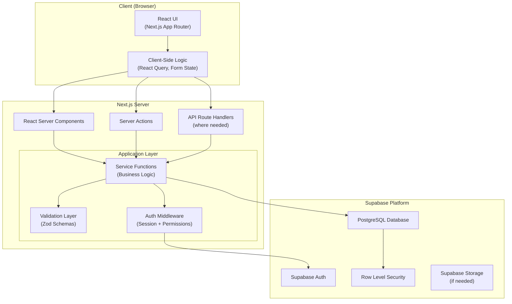
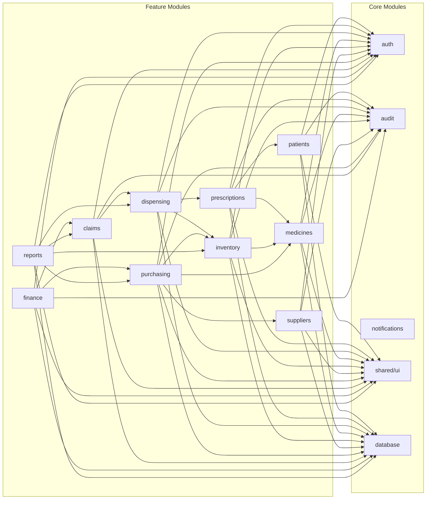
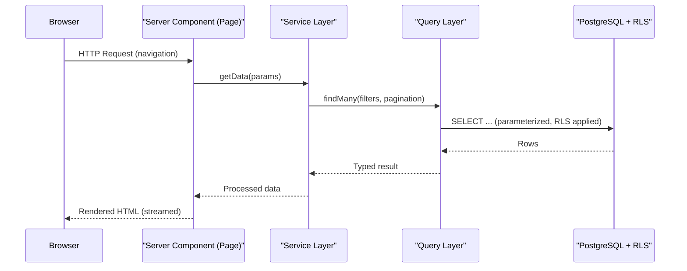
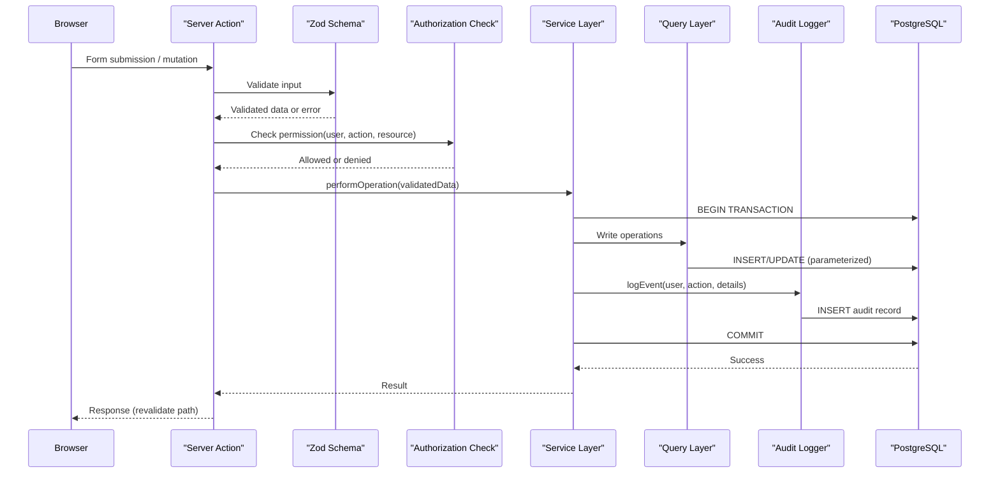
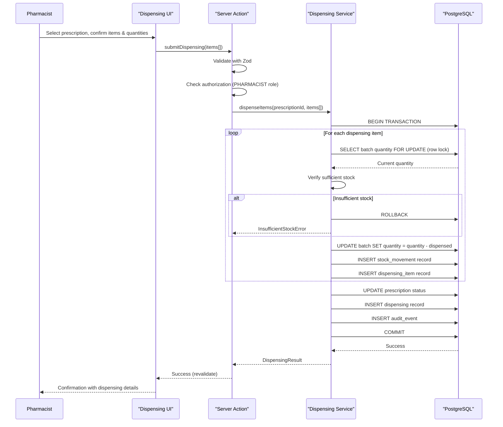
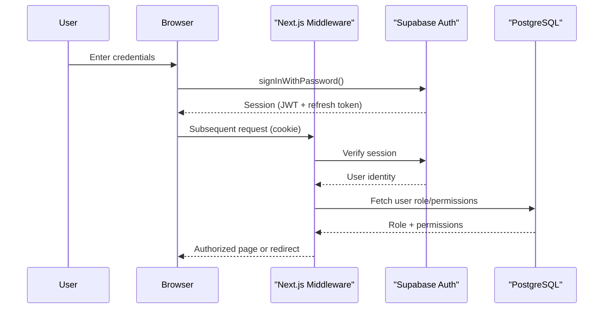
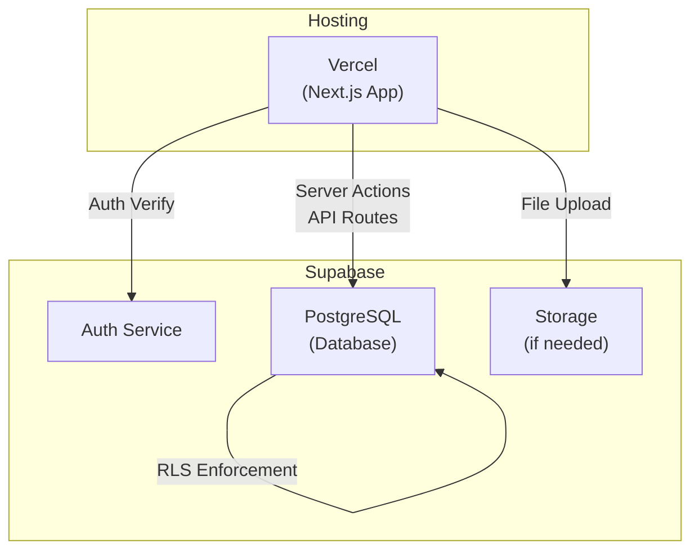

# MedLedger — Architecture

> **Version:** 0.1.0 (Phase 1 — Planning)
> **Last Updated:** 2026-10-13
> **Status:** Draft — Awaiting Review

---

## 1. Architecture Style: Modular Monolith

MedLedger is designed as a **modular monolith** deployed as a single Next.js application. This is the right choice for this project because:

- The team is small (1–3 developers). Microservices would introduce unnecessary operational complexity.
- All modules share a single PostgreSQL database. There is no current requirement for independent scaling.
- Module boundaries are enforced through directory structure, TypeScript module boundaries, and clear API contracts — not network boundaries.
- If a module ever needs to be extracted, the clean boundaries make that migration straightforward.

See [`ARCHITECTURE_DECISIONS.md`](file:///t:/DHQ%20KOhat%20Project/docs/ARCHITECTURE_DECISIONS.md) — ADR-001 for the full rationale.

---

## 2. System Architecture Diagram



---

## 3. Module Dependency Map



---

## 4. Layered Architecture

Each feature module follows a consistent internal structure with clear separation of concerns:

```
src/
├── app/                          # Next.js App Router (routing + pages)
│   ├── (auth)/                   # Auth-related routes (login, etc.)
│   ├── (dashboard)/              # Authenticated layout group
│   │   ├── patients/
│   │   ├── prescriptions/
│   │   ├── dispensing/
│   │   ├── medicines/
│   │   ├── inventory/
│   │   ├── suppliers/
│   │   ├── purchasing/
│   │   ├── claims/
│   │   ├── finance/
│   │   ├── reports/
│   │   ├── settings/
│   │   └── layout.tsx            # Dashboard shell (sidebar, header)
│   ├── api/                      # API route handlers (minimal use)
│   ├── layout.tsx                # Root layout
│   └── page.tsx                  # Landing / redirect
│
├── modules/                      # Feature modules (business logic)
│   ├── patients/
│   │   ├── actions/              # Server Actions
│   │   ├── services/             # Business logic functions
│   │   ├── queries/              # Database query functions
│   │   ├── schemas/              # Zod validation schemas
│   │   ├── types/                # TypeScript types and interfaces
│   │   └── components/           # Module-specific UI components
│   ├── prescriptions/
│   ├── dispensing/
│   ├── medicines/
│   ├── inventory/
│   ├── suppliers/
│   ├── purchasing/
│   ├── claims/
│   ├── finance/
│   ├── reports/
│   └── notifications/
│
├── core/                         # Cross-cutting concerns
│   ├── auth/                     # Authentication utilities
│   ├── authorization/            # Permission checking
│   ├── audit/                    # Audit logging
│   ├── database/                 # Supabase client, connection helpers
│   ├── errors/                   # Error types and handling
│   └── config/                   # Application configuration
│
├── components/                   # Shared/reusable UI components
│   ├── ui/                       # shadcn/ui components
│   ├── layout/                   # Layout components (sidebar, header)
│   ├── forms/                    # Reusable form components
│   ├── tables/                   # Data table components
│   └── feedback/                 # Loading, error, empty states
│
├── hooks/                        # Shared React hooks
├── lib/                          # Utility functions
├── styles/                       # Global styles, Tailwind config
└── types/                        # Global TypeScript types
```

### 4.1 Layer Responsibilities

| Layer              | Location                                    | Responsibility                                             | Rules                                                                                               |
| ------------------ | ------------------------------------------- | ---------------------------------------------------------- | --------------------------------------------------------------------------------------------------- |
| **Presentation**   | `app/`, `components/`, module `components/` | Render UI, handle user interactions, display state.        | No direct database calls. No business logic beyond form validation and display logic.               |
| **Server Actions** | Module `actions/`                           | Entry points for mutations from the client.                | Validate input (Zod), check authorization, delegate to service functions. Thin — no business logic. |
| **Service**        | Module `services/`                          | Business rules, orchestration, transaction coordination.   | Framework-agnostic. No React imports. No direct UI concerns. Calls queries and core modules.        |
| **Query**          | Module `queries/`                           | Database reads and writes. SQL construction.               | No business logic. Returns typed data. Uses parameterized queries only.                             |
| **Schema**         | Module `schemas/`                           | Zod schemas for validation.                                | Shared between client (form validation) and server (action validation).                             |
| **Core**           | `core/`                                     | Cross-cutting infrastructure: auth, audit, errors, config. | Used by all modules. No feature-specific logic.                                                     |

### 4.2 Key Architectural Rules

1. **Business logic lives in `services/`, not in Server Actions or React components.**
   - Server Actions validate, authorize, and delegate. They do not contain business rules.
   - React components render state. They do not compute business outcomes.

2. **Database access is restricted to `queries/` functions.**
   - Services call query functions. They never construct SQL or call Supabase directly.
   - This makes queries testable, replaceable, and auditable.

3. **Validation is defined once in `schemas/` and used on both client and server.**
   - Client-side: immediate feedback for the user.
   - Server-side: authoritative enforcement. Never trust client-side validation alone.

4. **Modules communicate through well-defined service interfaces, not by importing each other's queries.**
   - Example: the dispensing module calls `inventoryService.deductStock()`, not `inventoryQueries.updateBatchQuantity()`.

5. **Cross-cutting concerns (auth, audit, errors) are handled by `core/` modules, not duplicated across features.**

---

## 5. Data Flow Patterns

### 5.1 Read Path (Server Components)



### 5.2 Write Path (Server Actions)



### 5.3 Dispensing Transaction Flow (Critical Path)



> [!IMPORTANT]
> The dispensing flow uses `SELECT ... FOR UPDATE` to obtain row-level locks on batch records, preventing concurrent dispensing from creating negative stock. The entire operation executes within a single database transaction. If any item fails, the entire dispensing is rolled back.

---

## 6. Key Technical Decisions Summary

| Decision             | Choice                                                          | Rationale                                                                              |
| -------------------- | --------------------------------------------------------------- | -------------------------------------------------------------------------------------- |
| Architecture style   | Modular monolith                                                | Small team, shared database, minimal operational overhead.                             |
| Rendering strategy   | Server Components (default) + Client Components (interactivity) | Minimize client JS, secure data fetching, fast initial loads.                          |
| Mutations            | Server Actions                                                  | Type-safe, colocated with forms, built-in progressive enhancement.                     |
| State management     | React Server Components + React Query (where needed)            | Server-first. Client cache only for highly interactive views.                          |
| Database client      | Supabase JS SDK (server-side, service role key)                 | Bypasses RLS when needed for admin operations. Regular client for user-scoped queries. |
| Transaction handling | PostgreSQL functions (RPC) or Supabase transaction helpers      | Critical operations (dispensing, stock adjustments) require atomic transactions.       |
| Validation           | Zod schemas shared between client and server                    | Single source of truth for data shape. Type inference for TypeScript.                  |
| Error handling       | Typed error results (not thrown exceptions for expected errors) | Predictable control flow. Thrown exceptions reserved for unexpected failures.          |
| Audit logging        | Database-level audit table, written within the same transaction | Ensures audit records are never lost if the main operation succeeds.                   |

---

## 7. Authentication & Authorization Architecture

### 7.1 Authentication Flow



### 7.2 Authorization Layers

Authorization is enforced at **three levels** — defense in depth:

| Layer        | Mechanism                                       | Purpose                                                                                     |
| ------------ | ----------------------------------------------- | ------------------------------------------------------------------------------------------- |
| **UI**       | Conditional rendering based on role             | Hide unavailable actions (UX convenience, not security).                                    |
| **Server**   | Permission check in Server Actions / API routes | Reject unauthorized operations before they reach business logic.                            |
| **Database** | PostgreSQL Row Level Security (RLS)             | Final enforcement. Even if server code has a bug, the database rejects unauthorized access. |

> [!WARNING]
> Hiding a button in the UI is **not** security. Every mutation must be checked at the server layer, and RLS provides an additional safety net at the database layer.

### 7.3 Permission Model

Permissions follow a **role-based access control (RBAC)** model:

```
User → has one → Role → has many → Permissions
```

Permissions are structured as `module:action` pairs (e.g., `dispensing:create`, `inventory:adjust`, `claims:approve`).

The permission set is stored in the database and cached per session. Changes to a user's role take effect on their next session refresh.

> [!NOTE]
> Final roles and their permission assignments must be confirmed with the client. See [`OPEN_QUESTIONS.md`](file:///t:/DHQ%20KOhat%20Project/docs/OPEN_QUESTIONS.md) — OQ-003.

---

## 8. Error Handling Strategy

### 8.1 Error Categories

| Category                    | Example                                                   | Handling                                                     |
| --------------------------- | --------------------------------------------------------- | ------------------------------------------------------------ |
| **Validation Error**        | Invalid date format, missing required field.              | Return structured field-level errors to the form.            |
| **Authorization Error**     | User lacks permission for the action.                     | Return generic "not authorized" message. Log the attempt.    |
| **Business Rule Violation** | Insufficient stock, prescription already fully dispensed. | Return a user-friendly explanation. No stack trace.          |
| **Conflict Error**          | Concurrent edit detected (optimistic locking).            | Prompt user to refresh and retry.                            |
| **Infrastructure Error**    | Database connection failure, timeout.                     | Log full error. Show generic "something went wrong" to user. |

### 8.2 Error Result Pattern

Server Actions return typed results, not thrown exceptions:

```typescript
type ActionResult<T> =
  | { success: true; data: T }
  | { success: false; error: { code: string; message: string; fields?: Record<string, string[]> } };
```

This ensures the UI always receives a predictable shape and can render appropriate feedback without try/catch guessing.

---

## 9. Caching and Data Fetching Strategy

| Pattern                                       | When to Use                                                                                              |
| --------------------------------------------- | -------------------------------------------------------------------------------------------------------- |
| **Server Components (no cache)**              | Default for all data-driven pages. Fresh data on every navigation.                                       |
| **Server Components (with `revalidatePath`)** | After mutations, revalidate the affected page data.                                                      |
| **React Query (client-side)**                 | Interactive UIs needing optimistic updates, polling, or complex cache (e.g., live search in dispensing). |
| **Unstable_cache / Data Cache**               | Rarely-changing reference data (medicine categories, role lists). Short TTL with revalidation on write.  |

> The default is **no caching**. Caching is added deliberately where measured performance requires it. Premature caching of stock data is explicitly avoided — stale stock quantities are dangerous.

---

## 10. Background and Scheduled Operations

The initial deployment does not require a dedicated background job system. The following operations may need scheduled execution in later phases:

| Operation                 | Frequency | Approach                                    |
| ------------------------- | --------- | ------------------------------------------- |
| Expiry alerts             | Daily     | Supabase pg_cron or Next.js cron API route. |
| Low stock alerts          | Daily     | Same as above.                              |
| Overdue payment reminders | Weekly    | Same as above.                              |
| Audit log archival        | Monthly   | Database function or manual export.         |

If the requirements grow beyond simple scheduled queries, a lightweight job queue (e.g., `pg_boss` running in PostgreSQL) can be evaluated. A separate job service or message broker is not justified at this stage.

---

## 11. Deployment Architecture (Planned)



> [!NOTE]
> Deployment platform (Vercel, self-hosted, or other) is a decision for a later phase. The architecture is designed to be portable. See [`OPEN_QUESTIONS.md`](file:///t:/DHQ%20KOhat%20Project/docs/OPEN_QUESTIONS.md) — OQ-010.
