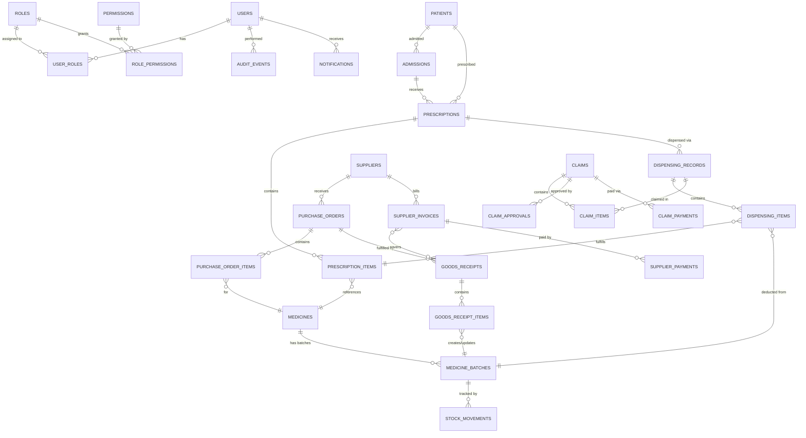

# MedLedger — Database Design & Schema Specification

> **Version:** 0.9.0 (Phase 9: Hospital Claims & Billing Workflow)
> **Last Updated:** 2026-10-13
> **Status:** Implemented (Schema & Migrations Active in `supabase/migrations/`, Application Modules in `src/modules/`)
> **Purpose:** 28-table relational PostgreSQL schema, constraints, partial unique indexes, RLS policies, immutability triggers, procurement/payables lifecycle, atomic dispensing RPCs, and hospital reimbursement claims engine for DHQ Hospital Kohat central pharmacy.

---

## 1. Design Principles

1. **Referential integrity is non-negotiable.** Foreign keys are enforced at the database level, not just in application code.
2. **Stock-affecting operations use database transactions.** Application-level checks alone are insufficient.
3. **Audit events are written within the same transaction** as the operation they record.
4. **Soft deletes for business entities.** Patients, prescriptions, and financial records are never physically deleted. A `deleted_at` timestamp marks removal.
5. **Timestamps on all records.** `created_at` and `updated_at` on every table. Audit-relevant tables also track `created_by` and `updated_by`.
6. **UUIDs for primary keys.** Prevents enumeration attacks and simplifies multi-environment data management.
7. **Monetary values stored as integers** (smallest currency unit, e.g., paisa) or `NUMERIC(12,2)`. Never floating point.
8. **Enums defined as PostgreSQL `CHECK` constraints or reference tables**, not application-level string conventions.
9. **Partial unique indexes for soft-deleted tables.** Tables with soft delete (`deleted_at`) must enforce uniqueness via partial unique indexes (`WHERE deleted_at IS NULL`) so soft deletion does not permanently block reusing identifiers (e.g., `mr_number`, `admission_number`).

---

## 2. High-Level Entity Relationship Diagram

---

## 3. Entity Descriptions

### 3.1 Identity & Access

| Entity               | Purpose                                                 | Key Fields                                                                                |
| -------------------- | ------------------------------------------------------- | ----------------------------------------------------------------------------------------- |
| **users**            | System users (staff accounts). Linked to Supabase Auth. | `id` (UUID, matches auth.users), `full_name`, `email`, `phone`, `is_active`, `created_at` |
| **roles**            | Named roles (e.g., pharmacist, pharmacy_manager).       | `id`, `name` (unique), `description`                                                      |
| **user_roles**       | Many-to-many assignment of roles to users.              | `user_id`, `role_id`, `assigned_at`, `assigned_by`                                        |
| **permissions**      | Granular permissions (e.g., `dispensing:create`).       | `id`, `code` (unique), `description`, `module`                                            |
| **role_permissions** | Many-to-many assignment of permissions to roles.        | `role_id`, `permission_id`                                                                |

### 3.2 Patients & Admissions

| Entity         | Purpose                                                                       | Key Fields                                                                                                                                                                       |
| -------------- | ----------------------------------------------------------------------------- | -------------------------------------------------------------------------------------------------------------------------------------------------------------------------------- |
| **patients**   | Patient demographic information.                                              | `id`, `mr_number` (unique, Medical Record Number), `full_name`, `father_name`, `cnic`, `date_of_birth`, `gender`, `phone`, `address`, `created_at`, `deleted_at`                 |
| **admissions** | Hospital admission records. A patient may have multiple admissions over time. | `id`, `patient_id` (FK), `admission_number` (unique), `admission_date`, `discharge_date`, `ward`, `bed_number`, `attending_doctor`, `status` (admitted/discharged), `created_at` |

### 3.3 Prescriptions

| Entity                 | Purpose                                                                     | Key Fields                                                                                                                                                                                                                            |
| ---------------------- | --------------------------------------------------------------------------- | ------------------------------------------------------------------------------------------------------------------------------------------------------------------------------------------------------------------------------------- |
| **prescriptions**      | Header for a prescription. Links to patient and optionally to an admission. | `id`, `prescription_number` (unique), `patient_id` (FK), `admission_id` (FK, nullable), `prescriber_name`, `prescription_date`, `status` (pending/partially_dispensed/fully_dispensed/cancelled), `notes`, `created_by`, `created_at` |
| **prescription_items** | Individual items on a prescription.                                         | `id`, `prescription_id` (FK), `medicine_id` (FK), `prescribed_quantity`, `dispensed_quantity` (running total), `dosage_instructions`, `status` (pending/partially_dispensed/fully_dispensed/cancelled), `notes`                       |

### 3.4 Dispensing

| Entity                 | Purpose                                                                                        | Key Fields                                                                                                                                  |
| ---------------------- | ---------------------------------------------------------------------------------------------- | ------------------------------------------------------------------------------------------------------------------------------------------- |
| **dispensing_records** | A dispensing event against a prescription. Multiple records support partial/repeat dispensing. | `id`, `dispensing_number` (unique), `prescription_id` (FK), `dispensed_by` (FK to users), `dispensed_at`, `notes`, `created_at`             |
| **dispensing_items**   | Individual items dispensed in a dispensing event.                                              | `id`, `dispensing_record_id` (FK), `prescription_item_id` (FK), `medicine_batch_id` (FK), `quantity_dispensed`, `unit_price`, `total_price` |

### 3.5 Medicine Catalogue & Inventory (Phase 6 Implementation)

| Entity               | Purpose                                                              | Key Fields                                                                                                                                                                                                                                                                                                                                                                                                                                |
| -------------------- | -------------------------------------------------------------------- | ----------------------------------------------------------------------------------------------------------------------------------------------------------------------------------------------------------------------------------------------------------------------------------------------------------------------------------------------------------------------------------------------------------------------------------------- |
| **medicines**        | Master catalogue of medicines. Enforces `UNIQUE(name, strength)`.    | `id`, `catalogue_code`, `name` (brand), `generic_name`, `dosage_form` (tablet/capsule/syrup/suspension/injection/infusion/topical/drops/inhaler/suppository), `strength`, `unit_of_measure`, `category`, `manufacturer`, `package_size`, `dispensing_unit`, `min_threshold`, `max_threshold`, `shelf_location`, `storage_conditions`, `is_active`, `created_at`                                                                           |
| **medicine_batches** | Batch-level inventory. Enforces `UNIQUE(medicine_id, batch_number)`. | `id`, `medicine_id` (FK), `batch_number`, `expiry_date`, `quantity_on_hand`, `quantity_received`, `unit_cost`, `pack_purchase_price`, `supplier_id` (FK, nullable), `receipt_reference`, `status` (`active`/`quarantined`/`expired`/`depleted`), `created_at`                                                                                                                                                                             |
| **stock_movements**  | Append-only immutable ledger of every stock mutation.                | `id`, `medicine_batch_id` (FK), `medicine_id` (FK), `movement_type` (`opening_balance`/`goods_receipt`/`dispensing`/`adjustment_increase`/`adjustment_decrease`/`quarantine`/`write_off`/`return`), `quantity` (positive for credit, negative for debit), `balance_before`, `balance_after`, `reference_type`, `reference_id`, `reason`, `notes`, `performed_by` (FK to users), `performed_by_name`, `client_mutation_id`, `performed_at` |

> [!IMPORTANT]
> **Authoritative Inventory Invariants (Phase 6):**
>
> 1. `medicine_batches.quantity_on_hand` is the authoritative balance. It is updated **only** within transactional operations that synchronously append a corresponding row to `stock_movements`.
> 2. `quantity_on_hand >= 0` is strictly enforced at both schema constraint and application levels; deductions exceeding on-hand quantities are rejected.
> 3. Batches with distinct expiry dates, costs, or origins are never merged.
> 4. Expired batches (`expiry_date <= CURRENT_DATE`) are excluded from available dispensing quantities and must undergo authorized quarantine or write-off workflows.
> 5. Stock adjustments require an authorized business reason (`physical_count_variance`, `damaged_in_storage`, `expired_stock`, `spillage_breakage`, `data_entry_correction`, `other`) and are audit logged.
> 6. Idempotency keys (`client_mutation_id`) protect against duplicate submissions.

### 3.6 Suppliers & Purchasing (Phase 7 Implementation)

| Entity                   | Purpose                                                                          | Key Fields                                                                                                                                                                                                                                                         |
| ------------------------ | -------------------------------------------------------------------------------- | ------------------------------------------------------------------------------------------------------------------------------------------------------------------------------------------------------------------------------------------------------------------ |
| **suppliers**            | Master distributor directory with contact and tax credentials.                   | `id`, `name` (unique), `contact_person`, `phone`, `email`, `address`, `ntn_number` (unique, nullable), `is_active`, `created_at`, `updated_at`, `deleted_at`                                                                                                       |
| **purchase_orders**      | Orders issued to pharmaceutical distributors.                                    | `id`, `po_number` (unique), `supplier_id` (FK), `supplier_name`, `order_date`, `expected_delivery_date`, `status` (`draft`/`submitted`/`partially_received`/`fully_received`/`cancelled`), `total_amount` (numeric), `notes`, `created_by` (FK), `created_at`      |
| **purchase_order_items** | Line items on a purchase order with agreed unit costs.                           | `id`, `purchase_order_id` (FK), `medicine_id` (FK), `medicine_name`, `medicine_strength`, `quantity_ordered`, `quantity_received` (running total), `unit_cost` (numeric), `total_cost` (numeric)                                                                   |
| **goods_receipts**       | Physical intake ledger (Goods Receipt Notes) against purchase orders.            | `id`, `grn_number` (unique), `purchase_order_id` (FK), `purchase_order_number`, `supplier_id` (FK), `supplier_name`, `received_date`, `received_by` (FK), `received_by_name`, `delivery_challan_number`, `supplier_invoice_number`, `notes`, `created_at`          |
| **goods_receipt_items**  | Individual medicine intake lines with lot, expiry, accepted/rejected quantities. | `id`, `goods_receipt_id` (FK), `purchase_order_item_id` (FK), `medicine_id` (FK), `medicine_name`, `batch_number`, `expiry_date`, `quantity_received`, `quantity_accepted`, `quantity_rejected`, `rejection_reason`, `unit_cost` (numeric), `total_cost` (numeric) |

> [!IMPORTANT]
> **Goods Receiving & Stock Intake Invariants (Phase 7):**
>
> 1. Goods receiving intake routes **exclusively** through the shared `inventoryStore.receiveGoodsBatch(...)` transactional mechanism. Direct stock table manipulation is strictly forbidden.
> 2. Every accepted intake atomically credits the batch on-hand quantity and synchronously creates an append-only `stock_movements` record of type `goods_receipt`.
> 3. Rejected quantities (`quantity_rejected > 0`) are recorded on the GRN item along with the rejection reason for vendor discrepancy tracking, but are **strictly excluded** from stock increments.
> 4. Over-receipt protection prevents receiving quantities that exceed the outstanding quantity on the purchase order line (`quantity_received <= quantity_ordered - existing_received`).
> 5. Expiry enforcement requires `expiry_date > CURRENT_DATE`. Past-dated batches are rejected at validation.

### 3.7 Supplier Payables & Multi-Invoice Allocations (Phase 7 Implementation)

| Entity                           | Purpose                                                               | Key Fields                                                                                                                                                                                                                                                                                                                                            |
| -------------------------------- | --------------------------------------------------------------------- | ----------------------------------------------------------------------------------------------------------------------------------------------------------------------------------------------------------------------------------------------------------------------------------------------------------------------------------------------------- |
| **supplier_invoices**            | Commercial invoices received from suppliers against GRNs or POs.      | `id`, `invoice_number`, `supplier_id` (FK), `supplier_name`, `purchase_order_id` (FK, nullable), `purchase_order_number`, `goods_receipt_id` (FK, nullable), `goods_receipt_number`, `invoice_date`, `due_date`, `total_amount`, `paid_amount`, `outstanding_balance`, `status` (`pending`/`partially_paid`/`paid`/`disputed`), `notes`, `created_at` |
| **supplier_payments**            | Payment disbursement vouchers issued to suppliers.                    | `id`, `voucher_number` (unique), `supplier_id` (FK), `supplier_name`, `payment_date`, `total_amount` (numeric), `payment_method` (`bank_transfer`/`cheque`/`cash`/`online`), `reference_number`, `notes`, `recorded_by` (FK), `recorded_by_name`, `created_at`                                                                                        |
| **supplier_payment_allocations** | 1-to-many allocation distributing a payment across multiple invoices. | `id`, `payment_id` (FK), `invoice_id` (FK), `invoice_number`, `allocated_amount` (numeric), `created_at`                                                                                                                                                                                                                                              |

> [!NOTE]
> **Financial & Allocation Rules:**
>
> 1. Monetary calculations are executed via `src/lib/decimal.ts` (`roundMoney`, `multiplyMoney`, `addMoney`, `subtractMoney`) using 2-decimal fixed precision. Binary floating-point arithmetic is never used for authoritative ledger totals.
> 2. A single disbursement voucher may settle or partially settle multiple outstanding invoices from the same supplier.
> 3. Payment allocation validation enforces that the sum of line allocations matches the total payment amount, and no line allocation exceeds the invoice's remaining outstanding balance.
> 4. Invoice balances and status (`pending` -> `partially_paid` -> `paid`) are updated atomically with voucher creation.

### 3.8 Hospital Claims & Billing

| Entity              | Purpose                                             | Key Fields                                                                                                                                                                                                                        |
| ------------------- | --------------------------------------------------- | --------------------------------------------------------------------------------------------------------------------------------------------------------------------------------------------------------------------------------- |
| **claims**          | Claims submitted to the hospital for reimbursement. | `id`, `claim_number` (unique), `claim_period_start`, `claim_period_end`, `total_amount`, `status` (draft/submitted/under_review/approved/partially_approved/rejected/paid), `submitted_by`, `submitted_at`, `notes`, `created_at` |
| **claim_items**     | Individual items included in a claim.               | `id`, `claim_id` (FK), `dispensing_record_id` (FK), `dispensing_item_id` (FK), `medicine_id` (FK), `quantity`, `unit_rate`, `total_amount`, `status` (pending/approved/rejected), `rejection_reason`                              |
| **claim_approvals** | Approval/rejection actions on a claim.              | `id`, `claim_id` (FK), `action` (approved/partially_approved/rejected/returned), `approved_by` (FK to users), `approved_amount`, `comments`, `approved_at`                                                                        |
| **claim_payments**  | Payments received from the hospital against claims. | `id`, `claim_id` (FK), `payment_date`, `amount`, `payment_method`, `reference_number`, `received_by` (FK to users), `created_at`                                                                                                  |

> [!NOTE]
> Claim rates (the `unit_rate` on claim items) must be configurable. The hospital may set different rates for different medicines or categories. This rate structure has **not been confirmed** by the client and must not be hard-coded.

### 3.9 Audit & Notifications

| Entity            | Purpose                                    | Key Fields                                                                                                                                                                                                                             |
| ----------------- | ------------------------------------------ | -------------------------------------------------------------------------------------------------------------------------------------------------------------------------------------------------------------------------------------- |
| **audit_events**  | Immutable log of all sensitive operations. | `id`, `event_type`, `entity_type`, `entity_id`, `user_id` (FK), `action` (create/update/delete/dispense/adjust/approve/etc.), `old_values` (JSONB, nullable), `new_values` (JSONB, nullable), `ip_address`, `user_agent`, `created_at` |
| **notifications** | System-generated notifications for users.  | `id`, `user_id` (FK), `type` (low_stock/expiry_alert/approval_needed/payment_due), `title`, `message`, `reference_type`, `reference_id`, `is_read`, `created_at`, `read_at`                                                            |

### 3.10 Configuration

| Entity            | Purpose                                                     | Key Fields                                                                       |
| ----------------- | ----------------------------------------------------------- | -------------------------------------------------------------------------------- |
| **system_config** | Key-value configuration for business rules that may change. | `id`, `key` (unique), `value` (JSONB), `description`, `updated_by`, `updated_at` |

---

## 4. Critical Constraints and Invariants

### 4.1 Stock Integrity

| Constraint                                             | Enforcement                                                    |
| ------------------------------------------------------ | -------------------------------------------------------------- |
| `quantity_on_hand >= 0`                                | `CHECK` constraint on `medicine_batches`.                      |
| Stock deduction only within transactions               | Application-level enforcement + `SELECT FOR UPDATE` row locks. |
| Sum of `stock_movements.quantity` = `quantity_on_hand` | Periodic reconciliation query. Mismatch triggers alert.        |
| Expired batches cannot be dispensed                    | Application check + database CHECK/trigger if feasible.        |

### 4.2 Dispensing Integrity

| Constraint                                           | Enforcement                                                        |
| ---------------------------------------------------- | ------------------------------------------------------------------ |
| `dispensed_quantity <= prescribed_quantity` per item | Application check within transaction.                              |
| Dispensing record must reference valid prescription  | Foreign key.                                                       |
| Prescription status reflects dispensing progress     | Updated within the same transaction as dispensing.                 |
| Duplicate dispensing prevention                      | Idempotency key on dispensing request + prescription status check. |

### 4.3 Financial Integrity

| Constraint                                  | Enforcement                                     |
| ------------------------------------------- | ----------------------------------------------- |
| Payment amounts are non-negative            | `CHECK` constraint.                             |
| Total payments do not exceed invoice amount | Application check within transaction.           |
| Claim amounts align with dispensed records  | Application validation during claim generation. |

### 4.4 Referential Integrity

All foreign keys have explicit `ON DELETE` behavior:

| Relationship                   | ON DELETE                                                                                                    |
| ------------------------------ | ------------------------------------------------------------------------------------------------------------ |
| Patient → Admission            | `RESTRICT` (cannot delete patient with admissions)                                                           |
| Prescription → Dispensing      | `RESTRICT`                                                                                                   |
| Medicine → Batch               | `RESTRICT`                                                                                                   |
| Batch → Stock Movement         | `RESTRICT`                                                                                                   |
| Purchase Order → Goods Receipt | `RESTRICT`                                                                                                   |
| Claim → Claim Items            | `RESTRICT` at DDL level (draft item cascade managed via application transaction; submitted claims protected) |

---

## 5. Indexing Strategy (Preliminary)

Indexes will be designed based on query patterns. The following are anticipated:

| Table                | Index                                  | Rationale                                      |
| -------------------- | -------------------------------------- | ---------------------------------------------- |
| `patients`           | `mr_number` (unique)                   | Primary lookup by medical record number.       |
| `patients`           | `cnic`                                 | Search by national ID.                         |
| `patients`           | `full_name` (trigram / `gin_trgm_ops`) | Fuzzy name search.                             |
| `prescriptions`      | `patient_id`, `status`                 | Find active prescriptions for a patient.       |
| `prescriptions`      | `prescription_number` (unique)         | Lookup by number.                              |
| `medicine_batches`   | `medicine_id`, `status`, `expiry_date` | Find available batches (FEFO ordering).        |
| `medicine_batches`   | `expiry_date`                          | Expiry alert queries.                          |
| `stock_movements`    | `medicine_batch_id`, `performed_at`    | Movement history for a batch.                  |
| `dispensing_records` | `prescription_id`                      | Find all dispensing events for a prescription. |
| `audit_events`       | `entity_type`, `entity_id`             | Audit trail for a specific entity.             |
| `audit_events`       | `user_id`, `created_at`                | User activity log.                             |
| `purchase_orders`    | `supplier_id`, `status`                | Orders by supplier.                            |
| `claims`             | `status`, `submitted_at`               | Pending claims for review.                     |
| `notifications`      | `user_id`, `is_read`                   | Unread notifications for a user.               |

---

## 6. Transaction Boundaries

The following operations require database transactions:

| Operation              | Tables Affected                                                                                                                           | Transaction Type                                    |
| ---------------------- | ----------------------------------------------------------------------------------------------------------------------------------------- | --------------------------------------------------- |
| **Dispense medicines** | `dispensing_records`, `dispensing_items`, `prescription_items`, `prescriptions`, `medicine_batches`, `stock_movements`, `audit_events`    | Read-write with row locks (`FOR UPDATE` on batches) |
| **Receive goods**      | `goods_receipts`, `goods_receipt_items`, `medicine_batches`, `purchase_order_items`, `purchase_orders`, `stock_movements`, `audit_events` | Read-write                                          |
| **Stock adjustment**   | `medicine_batches`, `stock_movements`, `audit_events`                                                                                     | Read-write with row lock                            |
| **Submit claim**       | `claims`, `claim_items`, `audit_events`                                                                                                   | Read-write                                          |
| **Approve claim**      | `claims`, `claim_approvals`, `audit_events`                                                                                               | Read-write                                          |
| **Record payment**     | `supplier_payments` or `claim_payments`, `invoices` or `claims` (status update), `audit_events`                                           | Read-write                                          |

> [!TIP]
> Complex transactions (especially dispensing) should be implemented as PostgreSQL functions (`RPC`) called from the application. This keeps the transaction boundary tight and avoids multiple round-trips between the application and database.

---

## 7. Data Retention Considerations

| Data Type                  | Retention                           | Notes                                                                 |
| -------------------------- | ----------------------------------- | --------------------------------------------------------------------- |
| Patient records            | Indefinite (soft delete)            | May need to align with local regulations.                             |
| Prescriptions & dispensing | Indefinite                          | Required for audit trail and claim validation.                        |
| Stock movements            | Indefinite                          | Essential for reconciliation and audit.                               |
| Audit events               | Indefinite (archive after 2+ years) | May be moved to cold storage for performance.                         |
| Notifications              | 90 days (configurable)              | Read notifications can be purged.                                     |
| Financial records          | 7+ years minimum                    | Standard financial record retention. Must confirm local requirements. |

> [!WARNING]
> Data retention policies for medical and financial records in Pakistan have not been confirmed with the client. See [`OPEN_QUESTIONS.md`](file:///t:/DHQ%20KOhat%20Project/docs/OPEN_QUESTIONS.md) — OQ-007.

---

## 8. Seed Data Strategy

For development and testing, the system will use realistic but clearly fictional dummy data:

- Patient names will use obviously fictional names (e.g., "Test Patient A-001").
- Financial figures will use realistic ranges but are not based on actual rates.
- All seed data records will be clearly marked or prefixed.
- Seed data will be loaded via a dedicated script that checks the environment before execution.
- The seed script will **refuse to run** in a production environment.

---

## 9. Migration Strategy (Phase 3 — Planned)

When the database phase begins:

1. Migrations will be managed using Supabase CLI (`supabase migration new`).
2. Each migration will be a numbered, sequential SQL file.
3. Migrations will be version-controlled and peer-reviewed.
4. Destructive migrations (column drops, type changes) require explicit approval.
5. Seed data is separate from schema migrations.
6. A rollback plan will accompany every migration.

---

## 10. Phase 8: Atomic Dispensing RPCs & Concurrency Locking

Migration: [`supabase/migrations/20261013000005_dispensing_rpc.sql`](file:///t:/DHQ%20KOhat%20Project/medledger/supabase/migrations/20261013000005_dispensing_rpc.sql)

### 10.1 `fn_dispense_prescription_atomic`

- **Execution Boundary:** Single PostgreSQL transaction enclosing prescription item validation, batch availability checks, stock deduction, append-only `stock_movements` creation, and prescription status transition.
- **Concurrency Mechanism:** Executes `SELECT quantity_on_hand, status, expiry_date FROM medicine_batches WHERE id = ... FOR UPDATE;` and `SELECT prescribed_quantity, dispensed_quantity FROM prescription_items WHERE id = ... FOR UPDATE;` to prevent race conditions across parallel dispensary counters.
- **Strict Invariants:**
  1. `quantity_on_hand >= p_quantity` (never negative stock).
  2. `status = 'available'` and `expiry_date > CURRENT_DATE` (quarantined or expired stock rejected at DB level).
  3. `dispensed_quantity + p_quantity <= prescribed_quantity` (over-dispensing rejected).
  4. Automatic rollback (`EXCEPTION WHEN OTHERS THEN RAISE;`) ensures that if any line in a multi-item prescription fails, zero stock is deducted and zero records are committed.

### 10.2 `fn_reverse_dispensing_atomic`

- **Execution Boundary:** Authorized compensating transaction that restores deducted stock back to the specific batch lots.
- **Double-Reversal Guard:** Re-verifies `dispensing_records.deleted_at IS NULL` under `FOR UPDATE` lock; raises exception if already reversed.
- **Traceability:** Creates compensating `stock_movements` rows with `movement_type = 'adjustment'`, `reference_type = 'dispensing_reversal'`, storing the audit reason, operator identity, and restoring prescription remaining balances.

---

## 11. Phase 9: Hospital Claims & Reimbursement RPCs

Migration: [`supabase/migrations/20261013000006_claims_rpc.sql`](file:///t:/DHQ%20KOhat%20Project/medledger/supabase/migrations/20261013000006_claims_rpc.sql)

### 11.1 Full Lifecycle Status State Machine

The `claims.status` check constraint supports the complete hospital reimbursement lifecycle:
`'draft' | 'submitted' | 'under_review' | 'approved' | 'partially_approved' | 'rejected' | 'returned' | 'partially_paid' | 'paid' | 'cancelled'`

- `draft`: Claim prepared and saved by pharmacy finance staff; can be edited or deleted.
- `submitted`: Finalized and transmitted for DHQ Hospital review; locks line items.
- `under_review`: Actively under evaluation by the hospital Medical Superintendent / Finance review committee.
- `approved`: Formally authorized for full reimbursement; approves all claim lines.
- `partially_approved`: Authorized with specific line-item adjustments or rejections.
- `rejected`: Fully rejected by hospital review committee; requires mandatory justification reason.
- `returned`: Returned to pharmacy billing staff for clinical or administrative clarification; allows revision and re-submission.
- `partially_paid`: Initial installment received from DHQ District Treasury (`paid_amount < approved_amount`).
- `paid`: Full approved reimbursement received (`paid_amount == approved_amount`, `outstanding_balance == 0`).
- `cancelled`: Revoked draft or returned claim.

### 11.2 `fn_create_claim_atomic`

- **Execution Boundary:** Single PostgreSQL transaction verifying that every line item references an exact, completed (not reversed) dispensing item (`dispensing_items.id`).
- **Duplicate Claim Safeguard:** Calculates total claimed quantity across active claims (`status NOT IN ('cancelled', 'rejected')`) under `FOR UPDATE` lock on `dispensing_items`. Throws exception if requested claim quantity exceeds remaining claimable quota (`quantity_dispensed - already_claimed`).
- **CRITICAL INVARIANT:** Claim creation and approval **NEVER** deducts inventory or touches `stock_movements`. Physical inventory was deducted strictly during the dispensing event.

### 11.3 `fn_review_claim_atomic`

- **Execution Boundary:** Atomic transition recording reviewer decision, approved amounts, line-item approvals/rejections, and entry in `claim_approvals`.
- **Audit Mandate:** Requires non-empty clinical/administrative comments for rejections, returns, or partial approvals.

### 11.4 `fn_record_claim_payment_atomic`

- **Execution Boundary:** Atomic payment recording in `claim_payments` with automatic transition to `partially_paid` or `paid`.
- **Over-Allocation Prevention:** Validates that `total_already_paid + p_amount <= claim.approved_amount` under row lock on `claims`. Prevents recording payments in excess of approved reimbursement.
