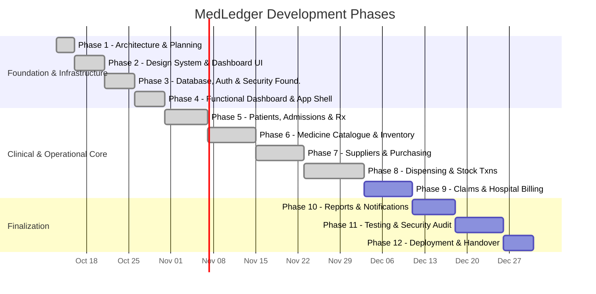
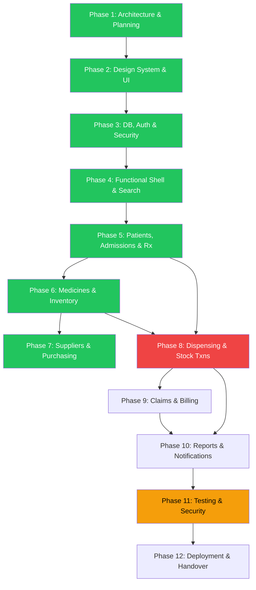

# MedLedger — Development Roadmap

> **Version:** 0.9.0 (Phase 9 — Hospital Claims & Billing Workflow)  
> **Last Updated:** 2026-10-13  
> **Status:** Phases 1 through 9 Completed & Verified

---

## Roadmap Overview

> [!NOTE]
> Foundation Phases 1–4, Clinical Intake Phase 5, Inventory Phase 6, Procurement Phase 7, and Dispensing Phase 8 are complete and verified. Hospital claims & billing (Phase 9) will follow sequentially.

---

## Phase 1: Architecture & Planning ✅ (Current Phase)

**Goal:** Establish technical foundation, architecture, and project standards.

| Deliverable                 | Status      |
| --------------------------- | ----------- |
| `PROJECT_OVERVIEW.md`       | ✅ Complete |
| `ARCHITECTURE.md`           | ✅ Complete |
| `DATABASE_DESIGN.md`        | ✅ Complete |
| `SECURITY_PLAN.md`          | ✅ Complete |
| `ENGINEERING_STANDARDS.md`  | ✅ Complete |
| `DEVELOPMENT_ROADMAP.md`    | ✅ Complete |
| `OPEN_QUESTIONS.md`         | ✅ Complete |
| `ARCHITECTURE_DECISIONS.md` | ✅ Complete |

**Acceptance Criteria:**

- [x] All eight documentation files created and internally consistent.
- [x] Architecture diagrams (Mermaid) included.
- [x] Open questions and assumptions clearly identified.
- [x] No application code or database migrations created.

---

## Phase 2: Professional Design System & Dashboard UI ✅ (Completed)

> [!NOTE]
> **Engineering Status Note (2026-10-13):** The professional design system, Tailwind CSS v4 CSS theme tokens, UI component primitives, deep-navy enterprise application shell, dynamic hospital operations dashboard, and centralized demo dataset have been built and verified. All linting, TypeScript strict mode, Vitest unit tests (6 test suites, 21 passing tests), Playwright E2E tests (4 passing tests), and Next.js 16 production build (`next build`) pass with 100% success. No database mutations, live credentials, or real patient records were introduced.

**Goal:** Build a complete, visually polished design system and dashboard frontend prototype with honest demo data.

**Prerequisites:** Phase 1 approved and committed (`2c38696`).

**Deliverables:**

| Deliverable             | Description                                                                                                                                   | Status      |
| ----------------------- | --------------------------------------------------------------------------------------------------------------------------------------------- | ----------- |
| Tailwind CSS v4 Tokens  | Custom brand palette (`#16324F`, `#159A9C`, `#176B87`), semantic status colors, surfaces, typography, shadows in `globals.css`.               | ✅ Complete |
| UI Primitives           | `Button`, `Badge`, `Card`, `Input`, `Table`, `Tabs`, `Alert`, `Skeleton`, `EmptyState`, `Dialog` in `src/components/ui/`.                     | ✅ Complete |
| Application Shell       | Enterprise deep-navy `Sidebar`, top `Header` with search & alert drawer, and responsive `AppShell` in `src/components/layout/`.               | ✅ Complete |
| Dashboard Page          | Welcome banner, 4 KPI cards, priority alerts panel, inventory breakdown bar, recent activity journal table, quick action cards.               | ✅ Complete |
| Centralized Demo Data   | Typed, consistent demo dataset (`kpiData`, `recentActivity`, `priorityAlerts`, `inventorySummary`, `quickActions`) in `src/lib/demo-data.ts`. | ✅ Complete |
| Navigation Placeholders | Clean, honest module preview cards with roadmap targets for all 11 sidebar links.                                                             | ✅ Complete |
| Automated Test Suites   | Unit tests for UI primitives & demo data integrity (Vitest) + end-to-end user flow verification (Playwright).                                 | ✅ Complete |

**Acceptance Criteria:**

- [x] Responsive layout validated across desktop, tablet, and mobile widths.
- [x] All interactive controls behave honestly with prototype notices; no unbacked functionality implied.
- [x] Zero console errors, zero hydration mismatches, and static prerendering on all routes.
- [x] `npm run typecheck`, `npm run lint`, `npm run format:check`, `npm run test`, and `npm run test:e2e` pass cleanly.
- [x] Production build (`npm run build`) completes successfully.
- [x] No database mutations, real patient information, or secret credentials introduced.

---

## Phase 3: Database, Authentication & Security Foundation ✅ (Completed)

> [!NOTE]
> **Implementation Document:** See [`docs/PHASE_3_IMPLEMENTATION.md`](file:///docs/PHASE_3_IMPLEMENTATION.md) for complete technical architecture, migration breakdown, RLS verification, and security controls.

**Goal:** Implement the database schema, version-controlled migrations, Row Level Security policies, audit trail immutability, and server-side RBAC utilities.

**Prerequisites:** Phase 2 design system verified.

**Deliverables:**

| Deliverable            | Description                                                                                  | Status      |
| ---------------------- | -------------------------------------------------------------------------------------------- | ----------- |
| Database Migrations    | 4 versioned SQL migrations covering all 28 tables in `supabase/migrations/`.                 | ✅ Complete |
| RLS Security Policies  | Default-deny Row Level Security policies across all tables in `00002_rls_policies.sql`.      | ✅ Complete |
| Immutability Triggers  | Strict PostgreSQL triggers preventing UPDATE/DELETE on `audit_logs` and `stock_movements`.   | ✅ Complete |
| Dev Seed Script        | Seed dataset with production safety guard (`00004_seed_dev_data.sql`).                       | ✅ Complete |
| Runtime Environment    | Zod-validated environment config with prototype fallback (`src/core/config/env.ts`).         | ✅ Complete |
| Supabase Clients       | `@supabase/ssr` server client with cookie adapter and browser client (`src/core/database/`). | ✅ Complete |
| RBAC Authorization     | Server-side authorization utilities, role definitions, and permission checks (`src/core/`).  | ✅ Complete |
| Immutable Audit Logger | Redacted, sanitized audit logging utility (`src/core/audit/audit-logger.ts`).                | ✅ Complete |

**Acceptance Criteria:**

- [x] All 28 tables, relationships, check constraints, and indexes defined and tested.
- [x] RLS enabled on all user tables with default-deny policies.
- [x] Immutability triggers verified by automated tests.
- [x] Development seed data script blocked from running in production.
- [x] Vitest suites verify migrations, authorization matrices, audit logger, and config.

---

## Phase 4: Functional Dashboard & Application Integration ✅ (Completed)

> [!NOTE]
> **Implementation Document:** See [`docs/PHASE_4_IMPLEMENTATION.md`](file:///docs/PHASE_4_IMPLEMENTATION.md) for data architecture details, server action contracts, and verification reports.

**Goal:** Integrate the dashboard into an enterprise application shell with typed data access boundaries, debounced search, system alerts drawer, accessible breadcrumbs, and honest prototype indicators.

**Prerequisites:** Phase 2 design system and Phase 3 database foundation verified.

**Deliverables:**

| Deliverable            | Description                                                                                       | Status      |
| ---------------------- | ------------------------------------------------------------------------------------------------- | ----------- |
| Data Access Boundary   | Typed server queries, demo provider, and Server Actions in `src/modules/dashboard/`.              | ✅ Complete |
| Debounced Search       | `Ctrl+K` search dialog with 300ms debounce, input constraints, and multi-entity results.          | ✅ Complete |
| Notifications Drawer   | Interactive system alerts popover with unread counter and "Mark all as read" action.              | ✅ Complete |
| Role Preview Switcher  | Provisional role preview switcher in user profile menu for evaluation of UI visibility.           | ✅ Complete |
| Breadcrumbs Navigation | Accessible breadcrumb component integrated into sub-module placeholders.                          | ✅ Complete |
| Resiliency Boundaries  | High-density loading skeleton (`loading.tsx`) and error boundary with retry action (`error.tsx`). | ✅ Complete |
| Honest Data Indicator  | Explicit UI badges and contracts separating live database connections from prototype demo data.   | ✅ Complete |
| Automated Quality      | 14 test suites (65 tests), 4 Playwright E2E tests, Prettier, ESLint, and Turbopack build pass.    | ✅ Complete |

**Acceptance Criteria:**

- [x] Dashboard integrated into consistent, accessible application shell.
- [x] Clean architectural separation between presentation, queries, and demo providers.
- [x] Real database used only when Supabase is configured; demo data explicitly identified otherwise.
- [x] Loading, empty, and error states gracefully handled.
- [x] Zero out-of-scope business transactions or fake authentication bypass introduced.
- [x] All quality checks (format, lint, typecheck, unit tests, E2E, build) pass with 100% success.

---

## Phase 5: Patients, Admissions & Prescriptions ✅ (Completed)

> [!NOTE]
> **Implementation Document:** See [`docs/PHASE_5_IMPLEMENTATION.md`](file:///docs/PHASE_5_IMPLEMENTATION.md) for complete technical architecture, data contracts, prescription transcription interfaces, and verification reports.

**Goal:** Implement enterprise patient management (registration, listing, search, pagination, duplicate MRN prevention), admission management (associated with patients, inpatient vs outpatient care, ward/bed/attending physician, discharge), and paper prescription entry (handwritten transcription interface, doctor slip warning, dynamic medicine line items with quantity & dosage instructions, zero-stock deduction invariant).

**Prerequisites:** Phase 3 database & security foundation and Phase 4 application shell complete and verified.

**Deliverables:**

| Deliverable                      | Description                                                                                                                                            | Status      |
| -------------------------------- | ------------------------------------------------------------------------------------------------------------------------------------------------------ | ----------- |
| Patient Directory & Pagination   | Server-side paginated patient table with debounced MRN/CNIC/name/phone search and status filtering.                                                    | ✅ Complete |
| Patient Registration & Edit      | Enterprise forms with Zod schema validation, Pakistani CNIC format enforcement (`^\d{5}-\d{7}-\d{1}$`), and duplicate MRN collision checks.            | ✅ Complete |
| Patient Details & History        | Patient profile displaying demographics, contact info, active admission status, and complete inpatient admission history.                              | ✅ Complete |
| Inpatient Admission Tracking     | Dedicated `/admissions` directory, admission modal on patient profile, ward/bed tracking, attending physician assignment, and discharge flow.          | ✅ Complete |
| Paper Prescription Transcription | `/prescriptions/new` handwritten intake interface with clinical disclaimer, dynamic medicine lines (frequency/route/duration), and note transcription. | ✅ Complete |
| Prescription Item Integrity      | Prescription items linked atomically to parent prescription context; zero orphan rows allowed.                                                         | ✅ Complete |
| Dispensing Boundary Guarantee    | Invariant strictly verified: prescription transcription creates orders only (`dispensed_quantity = 0`, `status = 'pending'`); zero stock deduction.    | ✅ Complete |
| Cancellation Lifecycle           | Prescription cancellation action with required audit reason, preventing modification of cancelled orders.                                              | ✅ Complete |
| Automated Quality Pipeline       | 17 test suites (102 unit tests), 7 Playwright E2E tests, Prettier, ESLint, TypeScript `--noEmit`, and Next.js Turbopack build pass with 100% success.  | ✅ Complete |

**Acceptance Criteria:**

- [x] Patients can be registered, searched, viewed, and updated with field-level error messages.
- [x] Duplicate MR numbers are prevented at both the schema and store levels.
- [x] CNIC is optional (not mandatory), but strictly validated against NADRA format when provided.
- [x] Admissions are linked to patients and support ward, bed, attending physician, and discharge tracking.
- [x] Outpatient care is fully supported (`admission_id` is optional on prescriptions).
- [x] Paper prescription entry transcribes handwritten slips with required clinical disclaimers.
- [x] Dynamic medicine line items capture medicine name/ID, dosage instructions, and prescribed quantity.
- [x] Prescription recording NEVER mutates inventory or deducts stock (verified by unit and integration tests).
- [x] All operations adhere to server-side RBAC and audit logging principles.
- [x] Zero mock or fake test assertions claiming live database validation when running in-memory.

---

## Phase 6: Medicine Catalogue & Inventory Management ✅ (Completed)

> [!NOTE]
> **Implementation Document:** See [`docs/PHASE_6_IMPLEMENTATION.md`](file:///docs/PHASE_6_IMPLEMENTATION.md) for complete technical architecture, batch models, append-only stock movement ledger, surveillance threshold rules, and verification reports.

**Goal:** Implement the medicine master catalogue, batch-level stock tracking, auditable stock movement ledger, low-stock/expiry alerts, and stock adjustments.

**Prerequisites:** Phase 3 database & security foundation and Phase 5 clinical intake complete and verified.

**Deliverables:**

| Deliverable            | Description                                                                                                                                           | Status      |
| ---------------------- | ----------------------------------------------------------------------------------------------------------------------------------------------------- | ----------- |
| Medicine Catalogue     | Paginated master catalogue with multi-field search (brand, generic, code, strength, category), registration, edit, and active status toggle.          | ✅ Complete |
| Batch Management       | Batch records tracking medicine ref, batch number, expiry date, quantity on hand, unit cost, pack price, and provenance. Prevent duplicate batches.   | ✅ Complete |
| Stock Movement Ledger  | Append-only, auditable ledger recording all stock mutations with balance before/after, actor, timestamp, reference document, and authorized reason.   | ✅ Complete |
| Non-Negative Invariant | Strict prevention of negative stock balances at both the database schema and application validation levels.                                           | ✅ Complete |
| Stock Adjustment Flow  | Authorized stock adjustment dialog with atomic batch balance and movement ledger recording, idempotency guard, and reason validation.                 | ✅ Complete |
| Surveillance Alerts    | Real-time alerts for low stock (<= 50 units default), out of stock, near expiry (<= 90 days default), and expired batches with accessible indicators. | ✅ Complete |
| Automated Test Suites  | 19 unit tests for medicines, 16 unit tests for inventory (100% passing), and 9 Playwright end-to-end integration tests.                               | ✅ Complete |

**Acceptance Criteria:**

- [x] Medicines can be added, searched, viewed, edited, and deactivated.
- [x] Batches track quantity on hand, expiry date, unit cost, and status.
- [x] Stock adjustments require an authorized reason and are audit-logged.
- [x] Quantity on hand can never be negative (enforced by application and database constraints).
- [x] Low-stock and FEFO expiry surveillance alerts accurately identify critical batches.
- [x] Stock movement history is complete, immutable, and preserves full traceability.
- [x] Zero out-of-scope prescription dispensing stock deductions or purchase order processing implemented.

---

## Phase 7: Suppliers, Purchasing & Goods Receiving ✅ (Completed)

> [!NOTE]
> **Implementation Document:** See [`docs/PHASE_7_IMPLEMENTATION.md`](file:///docs/PHASE_7_IMPLEMENTATION.md) for complete technical architecture, decimal-safe financial calculations, transactional goods receiving intake, and verification reports.

**Goal:** Implement supplier directory management, purchase order generation, goods receiving with atomic stock ledger intake, supplier invoices, and multi-invoice payment disbursements.

**Prerequisites:** Phase 3 database & security foundation and Phase 6 inventory foundation complete and verified.

**Deliverables:**

| Deliverable                  | Description                                                                                                                                            | Status      |
| ---------------------------- | ------------------------------------------------------------------------------------------------------------------------------------------------------ | ----------- |
| Supplier Directory & CRM     | Paginated supplier directory with search, contact information, NTN validation, active/inactive toggle, duplicate prevention, and spend analytics.      | ✅ Complete |
| Purchase Order Workflows     | Multi-line PO creator with supplier selection, catalogue medicine picker, decimal-safe line valuation, and delivery scheduling (`/purchases/new`).     | ✅ Complete |
| Purchase Order Lifecycle     | Status transitions (`draft` -> `submitted` -> `partially_received` -> `fully_received` -> `cancelled`) with line-level fulfillment tracking.           | ✅ Complete |
| Atomic Goods Receiving (GRN) | Physical intake dialog recording lot/batch number, future expiry, accepted/rejected breakdown, discrepancy notes, and supplier invoice reference.      | ✅ Complete |
| Unified Stock Ledger Intake  | Intake routes strictly through `inventoryStore.receiveGoodsBatch(...)`, synchronously crediting batches and creating `stock_movements` rows.           | ✅ Complete |
| Over-Receipt Prevention      | Server-side validation preventing intake exceeding remaining outstanding quantities on purchase order items.                                           | ✅ Complete |
| Rejected Goods Exclusion     | Damaged/rejected quantities are recorded on the GRN item with reason for vendor reporting, but strictly excluded from available inventory balances.    | ✅ Complete |
| Supplier Invoices & Payables | Commercial invoice tracking with total, paid, and outstanding balances linked to purchase orders and receipts (`/purchases?tab=invoices`).             | ✅ Complete |
| Multi-Invoice Disbursements  | Payment recording voucher supporting 1-to-many allocation across multiple outstanding invoices with strict monetary boundary checks.                   | ✅ Complete |
| Automated Quality Pipeline   | 21 Vitest test suites (168 unit tests, 100% pass), 11 Playwright E2E tests, Prettier, ESLint, TypeScript `--noEmit`, and Next.js Turbopack build pass. | ✅ Complete |

**Acceptance Criteria:**

- [x] Suppliers can be listed, searched, created, updated, and deactivated with unique name and optional NTN validation.
- [x] Purchase orders support multi-item line ordering with decimal-safe calculations (`src/lib/decimal.ts`).
- [x] Goods receiving atomically records intake into the shared inventory ledger via `receiveGoodsBatch(...)`.
- [x] Over-receipt is strictly prevented at the validation and transaction boundary.
- [x] Rejected items are excluded from inventory balance updates and tracked with discrepancy reasons.
- [x] Batches require future expiry dates (`expiry_date > CURRENT_DATE`).
- [x] Invoices correctly track paid vs. outstanding balances.
- [x] Multi-invoice payment allocation verifies total disbursement matches allocated lines without exceeding invoice balances.
- [x] All procurement mutations enforce server-side RBAC and audit logging.
- [x] Zero dispensing stock deductions or prescription modifications introduced.

---

## Phase 8: Dispensing & Atomic Stock Transactions ✅ (Completed)

> [!NOTE]
> **Implementation Document:** See [`docs/PHASE_8_IMPLEMENTATION.md`](file:///t:/DHQ%20KOhat%20Project/medledger/docs/PHASE_8_IMPLEMENTATION.md) for full architectural documentation, transaction boundaries, FEFO rules, rollback behavior, and verification reports.

**Goal:** Implement the staff-friendly dispensing workflow with atomic stock deduction, FEFO allocation, over-dispensing prevention, idempotency, and authorized compensating reversals.

**Prerequisites:** Phase 3 database/security, Phase 5 prescriptions, Phase 6 inventory, and Phase 7 purchasing completed and verified.

**Deliverables:**

| Deliverable                      | Description                                                                                                                             | Status      |
| -------------------------------- | --------------------------------------------------------------------------------------------------------------------------------------- | ----------- |
| Dispensing Workspace Counter     | Queue search by MRN/name/slip, active prescription selector, remaining authorized balance breakdown (`/dispensing`).                    | ✅ Complete |
| Batch Allocation & FEFO Engine   | Automated FEFO candidate evaluation (`evaluateFEFOBatches`), recommending earliest-expiring active batch, excluding expired lots.       | ✅ Complete |
| FEFO Override Audit Log          | Mandatory justified reason capture for overriding FEFO suggestions, recorded in immutable audit events.                                 | ✅ Complete |
| Clinical Substitution Tracking   | Explicit brand/generic substitution recording requiring mandatory reason and authorizing pharmacist attribution.                        | ✅ Complete |
| Atomic Multi-Item Transactions   | Single transactional boundary via `fn_dispense_prescription_atomic` RPC and `dispensingStore`: all items commit or all roll back.       | ✅ Complete |
| Authoritative Stock Deductions   | Deductions route strictly through `inventoryStore.dispenseBatchStock`, creating append-only `stock_movements` (type `dispensing`).      | ✅ Complete |
| Over-Dispensing Prevention       | Strict validation preventing dispensing more than the remaining authorized prescription quantity (`prescribed - dispensed`).            | ✅ Complete |
| Idempotency Protection           | Unique `idempotency_key` enforcement preventing duplicate stock deductions from double-clicks or retries.                               | ✅ Complete |
| Compensating Reversal Dialog     | Authorized reversal (`fn_reverse_dispensing_atomic`) restoring batch stocks and remaining prescription balance without double-restore.  | ✅ Complete |
| Printable Pharmacy Voucher       | Official printable dispensing voucher dialog (`DispensingReceiptDialog`) for ward and patient verification.                             | ✅ Complete |
| Dispensing History & Audit Table | Paginated dispensing history table with search, status filters (`completed`, `reversed`), and full item inspector (`/dispensing/[id]`). | ✅ Complete |
| Automated Quality Pipeline       | 22 Vitest test suites (185 unit tests, 100% pass), 12 Playwright E2E tests, Prettier, ESLint, TypeScript `--noEmit`, and Next.js build. | ✅ Complete |

**Acceptance Criteria:**

- [x] Dispensing deducts stock from the correct batch atomically.
- [x] Concurrent dispensing requests do not cause negative stock (PostgreSQL `FOR UPDATE` row locks).
- [x] Partial dispensing correctly tracks remaining quantities.
- [x] Repeat dispensing against the same prescription works correctly against outstanding balance.
- [x] Expired, quarantined, or depleted batches cannot be dispensed.
- [x] Dispensed quantity cannot exceed prescribed remaining authorized quantity.
- [x] Every dispensing event is fully audit-logged with authenticated actor identity.
- [x] Stock movement records are created for every deduction with complete batch traceability.
- [x] Transaction rollback works correctly on any failure, leaving stock and prescription balances untouched.
- [x] Compensating reversals restore stock cleanly without allowing duplicate reversals.
- [x] Zero hospital claims submission, claim approval, or payment settlement introduced out of scope.

---

## Phase 9: Hospital Claims & Billing Workflow ✅ (Completed)

> [!NOTE]
> **Implementation Document:** See [`docs/PHASE_9_IMPLEMENTATION.md`](file:///t:/DHQ%20KOhat%20Project/medledger/docs/PHASE_9_IMPLEMENTATION.md) for full architectural documentation, transaction boundaries, state transitions, duplicate prevention, and verification reports.

**Goal:** Implement hospital claim preparation from eligible dispensing records, approval review workflow, reimbursement payment allocations, and exact line-item fulfillment traceability without duplicate claims or stock deduction re-runs.

**Prerequisites:** Phase 3 database/security, Phase 5 prescriptions, Phase 6 inventory, Phase 7 purchasing, and Phase 8 dispensing completed and verified.

**Deliverables:**

| Deliverable                      | Description                                                                                                                                                  | Status      |
| -------------------------------- | ------------------------------------------------------------------------------------------------------------------------------------------------------------ | ----------- |
| Claims Management Hub            | Operational dashboard with 5 KPI summary cards, multi-status filter tabs, search by MRN/patient/claim, and action modals (`/claims`).                        | ✅ Complete |
| Eligible Dispensing Picker       | Real-time selector displaying finalized, unreversed dispensing items with remaining claimable quotas, MRN, batch, and dosage form.                           | ✅ Complete |
| Claim Compilation Form           | Multi-item claim builder with billing period start/end dates, live PKR valuation, and "Save Draft" vs "Submit for Review" (`/claims/new`).                   | ✅ Complete |
| Concurrency Duplicate Prevention | Authoritative server-side validation ensuring requested claim quantity does not exceed remaining claimable quantity (`dispensed - already_claimed`).         | ✅ Complete |
| Exact Line-Item Traceability     | Every `claim_items` row references exact `dispensing_item_id`, `dispensing_record_id`, patient, prescription, batch, and dispensing staff.                   | ✅ Complete |
| Full Lifecycle State Machine     | Validated transitions: `draft` -> `submitted` -> `under_review` -> `approved` / `partially_approved` / `rejected` / `returned` -> `partially_paid` / `paid`. | ✅ Complete |
| Review & Approval Dialog         | Review modal allowing reviewers to full/partial approve, return for correction, or reject with mandatory comments.                                           | ✅ Complete |
| Reimbursement Payment Ledger     | Payment modal recording hospital treasury disbursements, updating status to `partially_paid`/`paid`, and preventing over-allocation.                         | ✅ Complete |
| Claim Detail Inspection View     | Complete audit view with tabs for Line Items, Review Decisions, and Reimbursement Payments (`/claims/[id]`).                                                 | ✅ Complete |
| Automated Quality Pipeline       | 23 Vitest test suites (202 unit/integration tests, 100% pass), 13 Playwright E2E tests, Prettier, ESLint, TypeScript `--noEmit`, and Turbopack build.        | ✅ Complete |

**Acceptance Criteria:**

- [x] Claims can be prepared only from finalized, completed dispensing records.
- [x] Every claim item references the exact dispensing item it represents.
- [x] Duplicate claims for the same dispensing quantity are strictly prevented.
- [x] Partial claims track previously claimed and remaining claimable quantities concurrency-safely.
- [x] Claim processing NEVER alters or deducts inventory stock a second time.
- [x] Full state machine supported (`draft`, `submitted`, `under_review`, `approved`, `partially_approved`, `rejected`, `returned`, `partially_paid`, `paid`, `cancelled`).
- [x] Rejection and return require mandatory clinical or administrative comments.
- [x] All monetary amounts calculate with exact two-decimal precision using `src/lib/decimal.ts`.
- [x] Reimbursement payments cannot exceed approved amounts (over-allocation prevented).
- [x] All operations enforce server-side RBAC (`claims:read`, `claims:manage`) and structured audit events.

---

## Phase 12: Reports & Notifications

**Goal:** Implement operational reports and system notifications.

**Prerequisites:** Phases 6–11 complete.

**Deliverables:**

| Deliverable         | Description                                                                       |
| ------------------- | --------------------------------------------------------------------------------- |
| Stock status report | Current stock levels by medicine, with batch details.                             |
| Dispensing report   | Dispensing history by date range, patient, or medicine.                           |
| Purchase report     | Purchase order and payment summaries by date range or supplier.                   |
| Claim report        | Claim status summary by period.                                                   |
| Expiry report       | Medicines expiring within a configurable window.                                  |
| Financial summary   | Revenue (claims paid) vs. expenses (supplier payments).                           |
| Notification system | Low stock alerts, expiry alerts, pending approval alerts, overdue payment alerts. |
| Notification UI     | Bell icon with unread count, notification list, mark as read.                     |
| Scheduled checks    | Daily expiry and stock level checks (pg_cron or API cron).                        |
| Tests               | Report accuracy tests with known test data.                                       |

**Acceptance Criteria:**

- [ ] All reports display accurate data matching the underlying records.
- [ ] Reports support date range filtering and export (CSV minimum).
- [ ] Notifications are generated automatically based on configured thresholds.
- [ ] Notifications are visible in the UI with unread count.
- [ ] Scheduled checks run reliably.

---

## Phase 13: Integration Testing, Security Review & Performance Optimization

**Goal:** Comprehensive testing, security audit, and performance tuning.

**Prerequisites:** All feature phases complete.

**Deliverables:**

| Deliverable         | Description                                                                |
| ------------------- | -------------------------------------------------------------------------- |
| E2E test suite      | Playwright tests for all critical user flows.                              |
| Security audit      | Execute the security checklist from `SECURITY_PLAN.md`.                    |
| RLS audit           | Test every RLS policy with every role.                                     |
| Performance audit   | Identify and resolve slow queries, large payloads, unnecessary re-renders. |
| Load testing        | Simulate concurrent users for critical paths (dispensing).                 |
| Accessibility audit | Keyboard navigation, screen reader, contrast checks.                       |
| Bug fixes           | Address all critical and high-severity findings.                           |
| Documentation       | Update all `docs/` files to reflect final implementation.                  |

**Acceptance Criteria:**

- [ ] All E2E tests pass.
- [ ] Security checklist is fully completed (all items checked).
- [ ] No critical or high-severity bugs remain open.
- [ ] Common operations meet performance targets.
- [ ] RLS policies verified for all roles.
- [ ] Accessibility meets WCAG 2.1 AA for critical flows.
- [ ] Documentation reflects the final state of the application.

---

## Phase 14: Deployment, Backup Verification & Handover

**Goal:** Deploy to production, verify backups, train staff, and hand over.

**Prerequisites:** Phase 13 complete. All critical bugs fixed.

**Deliverables:**

| Deliverable                 | Description                                         |
| --------------------------- | --------------------------------------------------- |
| Production Supabase project | Configured with production-grade settings.          |
| Production deployment       | Application deployed to hosting platform.           |
| DNS & SSL                   | Custom domain (if required) with HTTPS.             |
| Backup verification         | Perform a test backup and restore.                  |
| Monitoring                  | Error tracking and uptime monitoring configured.    |
| Staff training              | Training sessions for each user role.               |
| User guide                  | Basic operational documentation for pharmacy staff. |
| Handover documentation      | Architecture, deployment, and operational runbook.  |
| Support plan                | Post-launch support period and escalation process.  |

**Acceptance Criteria:**

- [ ] Application is accessible at the production URL.
- [ ] HTTPS is enforced.
- [ ] Backup and restore has been tested successfully.
- [ ] Monitoring alerts are configured and tested.
- [ ] Staff have completed training.
- [ ] Handover documentation is complete and accurate.
- [ ] Post-launch support plan is agreed upon.

---

## Phase Dependency Summary

**Legend:**

- 🟢 Green (P1–P7): Completed & verified foundation, clinical intake, inventory, and purchasing phases.
- 🔴 Red (P8): Highest-risk phase — dispensing and inventory deduction transactions.
- 🟡 Yellow (P11): Critical quality gate — no deployment without passing comprehensive security and integration audit.
