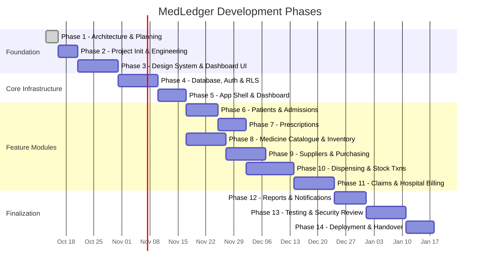
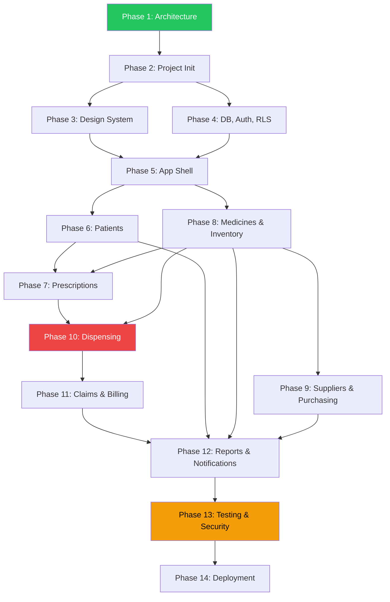

# MedLedger — Development Roadmap

> **Version:** 0.1.0 (Phase 1 — Planning)
> **Last Updated:** 2026-10-13
> **Status:** Draft — Awaiting Review

---

## Roadmap Overview

> [!NOTE]
> Durations are estimates and will be refined as work progresses. Phases 6–7 and Phase 8 can run in parallel if the team has capacity, since they don't depend on each other.

---

## Phase 1: Architecture & Planning ✅ (Current Phase)

**Goal:** Establish technical foundation, architecture, and project standards.

| Deliverable                 | Status      |
| --------------------------- | ----------- |
| `PROJECT_OVERVIEW.md`       | ✅ Complete |
| `ARCHITECTURE.md`           | ✅ Complete |
| `DATABASE_DESIGN.md`        | ✅ Complete |
| `SECURITY_PLAN.md`          | ✅ Complete |
| `ENGINEERING_STANDARDS.md`  | ✅ Complete |
| `DEVELOPMENT_ROADMAP.md`    | ✅ Complete |
| `OPEN_QUESTIONS.md`         | ✅ Complete |
| `ARCHITECTURE_DECISIONS.md` | ✅ Complete |

**Acceptance Criteria:**

- [x] All eight documentation files created and internally consistent.
- [x] Architecture diagrams (Mermaid) included.
- [x] Open questions and assumptions clearly identified.
- [x] No application code or database migrations created.

---

## Phase 2: Project Initialization & Engineering Setup

> [!NOTE]
> **Engineering Status Note (2026-10-13):** The Next.js repository scaffolding, tooling (TypeScript, ESLint, Prettier, Husky, lint-staged), testing suites (Vitest, Playwright), CI workflow, and modular directory skeleton were initialized in Git commit `71db268`. The engineering infrastructure is provisioned; formal Phase 1 review approval is required before proceeding to UI design system and domain logic.

**Goal:** Create the Next.js project with all tooling, linting, and development infrastructure configured.

**Prerequisites:** Phase 1 approved.

**Deliverables:**

| Deliverable          | Description                                                                     |
| -------------------- | ------------------------------------------------------------------------------- |
| Next.js project      | App Router, TypeScript strict mode, Tailwind CSS configured.                    |
| Linting & formatting | ESLint, Prettier, lint-staged, Husky pre-commit hooks.                          |
| Path aliases         | `@/` alias configured and verified.                                             |
| Test framework       | Vitest configured for unit and integration tests. Playwright installed for E2E. |
| Environment setup    | `.env.example` with all required variables. `.gitignore` configured.            |
| CI pipeline          | Basic GitHub Actions (or equivalent) for lint, type-check, and test.            |
| Directory structure  | Module directory skeleton created per architecture (no implementations).        |
| Documentation        | `README.md` with setup instructions.                                            |

**Acceptance Criteria:**

- [ ] `npm run dev` starts without errors.
- [ ] `npm run lint` passes with zero warnings.
- [ ] `npm run type-check` passes.
- [ ] `npm run test` runs (with placeholder test passing).
- [ ] All path aliases resolve correctly.
- [ ] Pre-commit hook catches lint violations.
- [ ] `.env.example` documents all required environment variables.

---

## Phase 3: Design System & Dashboard UI

**Goal:** Build the complete design system and dashboard UI components using Tailwind CSS and shadcn/ui.

**Prerequisites:** Phase 2 complete.

**Deliverables:**

| Deliverable           | Description                                                                            |
| --------------------- | -------------------------------------------------------------------------------------- |
| Tailwind theme        | Custom color palette, typography, spacing, border-radius tokens.                       |
| shadcn/ui components  | Button, Input, Select, Dialog, Toast, Card, Table, Badge, Dropdown Menu, Sidebar, etc. |
| Layout components     | Sidebar, Header, Breadcrumbs, Page container.                                          |
| Form components       | Form field wrapper, form section, validation display.                                  |
| Table components      | DataTable with pagination, sorting, filtering, empty states.                           |
| Feedback components   | Loading skeleton, error boundary, empty state, connectivity banner.                    |
| Design reference page | Internal page showcasing all components and states.                                    |

**Acceptance Criteria:**

- [ ] All shared components render correctly with all states (loading, error, empty, data).
- [ ] Components are accessible (keyboard navigation, ARIA labels, sufficient contrast).
- [ ] Design matches the approved visual direction.
- [ ] Component stories or reference page documents all variations.
- [ ] Responsive layout works on desktop and tablet.

---

## Phase 4: Database Schema, Authentication & RLS

**Goal:** Implement the database schema, authentication flow, and Row Level Security policies.

**Prerequisites:** Phase 2 complete. Database design approved by team.

**Deliverables:**

| Deliverable            | Description                                                                                     |
| ---------------------- | ----------------------------------------------------------------------------------------------- |
| Supabase project setup | Development and staging projects created.                                                       |
| Database migrations    | All tables, constraints, indexes, and RLS policies per `DATABASE_DESIGN.md`.                    |
| Authentication         | Supabase Auth configured. Login/logout flow implemented.                                        |
| User & role tables     | `users`, `roles`, `permissions`, `user_roles`, `role_permissions` populated with initial roles. |
| RLS policies           | Row Level Security policies on all user-facing tables.                                          |
| Seed script            | Development seed data script (blocked from running in production).                              |
| Auth middleware        | Next.js middleware for session verification.                                                    |
| Core auth utilities    | `getAuthenticatedUser()`, `hasPermission()`, `requirePermission()`.                             |

**Acceptance Criteria:**

- [ ] Users can log in and log out.
- [ ] Session persists across page reloads.
- [ ] Invalid/expired sessions redirect to login.
- [ ] RLS policies deny access for unauthorized roles (tested with SQL queries).
- [ ] Seed script creates realistic test data.
- [ ] Seed script refuses to run in production environment.
- [ ] `hasPermission()` correctly evaluates role-based permissions.
- [ ] All migrations are version-controlled and reversible.

---

## Phase 5: Application Shell & Dashboard Integration

**Goal:** Build the authenticated application shell and integrate the dashboard as the home page.

**Prerequisites:** Phase 3 (design system) and Phase 4 (auth) complete.

**Deliverables:**

| Deliverable          | Description                                                                                         |
| -------------------- | --------------------------------------------------------------------------------------------------- |
| Authenticated layout | Dashboard shell with sidebar, header, user menu.                                                    |
| Navigation           | Sidebar navigation reflecting user permissions (hide inaccessible items).                           |
| Dashboard page       | Summary cards with real data from the database (patient count, stock alerts, pending claims, etc.). |
| Login page           | Polished login page with validation and error handling.                                             |
| 404 / error pages    | Custom error pages matching the design system.                                                      |
| Breadcrumbs          | Automatic breadcrumbs based on route.                                                               |

**Acceptance Criteria:**

- [ ] Unauthenticated users are redirected to login.
- [ ] Dashboard loads with live summary data.
- [ ] Sidebar navigation reflects the user's role and permissions.
- [ ] Navigation between pages is fast and smooth.
- [ ] Login page handles errors gracefully (wrong password, network error).
- [ ] 404 and error pages are styled consistently.

---

## Phase 6: Patients & Admissions

**Goal:** Implement patient registration, search, and hospital admission management.

**Prerequisites:** Phase 5 complete.

**Deliverables:**

| Deliverable          | Description                                                       |
| -------------------- | ----------------------------------------------------------------- |
| Patient list         | Paginated, searchable list of patients.                           |
| Patient registration | Form with validation (name, CNIC, DOB, gender, phone, address).   |
| Patient details      | View and edit patient information.                                |
| Admission records    | Create, view, and update admission records linked to patients.    |
| Audit logging        | Patient creation, updates, and deletions logged.                  |
| Tests                | Unit tests for validation. Integration tests for CRUD operations. |

**Acceptance Criteria:**

- [ ] Patients can be registered, searched, viewed, and updated.
- [ ] Duplicate MR numbers are prevented.
- [ ] CNIC format is validated.
- [ ] Admissions are linked to patients and can be viewed/edited.
- [ ] Patient name search supports fuzzy matching.
- [ ] Pagination works correctly for large patient lists.
- [ ] All operations are audit-logged.

---

## Phase 7: Prescriptions

**Goal:** Implement prescription capture and management.

**Prerequisites:** Phase 6 (patients) complete. Phase 8 (medicine catalogue) at least partially complete (medicine list available).

**Deliverables:**

| Deliverable           | Description                                                                               |
| --------------------- | ----------------------------------------------------------------------------------------- |
| Prescription list     | Paginated list with status filtering.                                                     |
| Prescription creation | Form to capture prescriber, patient, admission, and prescribed items.                     |
| Prescription items    | Add/remove medicine items with quantity and dosage instructions.                          |
| Prescription detail   | View prescription with all items and dispensing history.                                  |
| Status tracking       | Prescription status reflects dispensing progress (pending → partially → fully dispensed). |
| Tests                 | Unit tests for validation. Integration tests for status transitions.                      |

**Acceptance Criteria:**

- [ ] Prescriptions can be created and linked to patients and admissions.
- [ ] Prescription items reference medicines from the catalogue.
- [ ] Prescription status is read-only (computed from dispensing state).
- [ ] Duplicate prescription numbers are prevented.
- [ ] Prescription detail shows dispensing history.
- [ ] All operations are audit-logged.

---

## Phase 8: Medicine Catalogue & Inventory

**Goal:** Implement the medicine master catalogue and inventory management.

**Prerequisites:** Phase 5 complete.

**Deliverables:**

| Deliverable        | Description                                                                       |
| ------------------ | --------------------------------------------------------------------------------- |
| Medicine catalogue | List, create, edit, and deactivate medicines.                                     |
| Medicine search    | Search by name, generic name, category.                                           |
| Batch management   | View batches for each medicine. Manual batch entry (for existing stock).          |
| Stock overview     | Current stock by medicine (aggregated across batches).                            |
| Stock movements    | View movement history for a batch.                                                |
| Expiry alerts      | List medicines with batches expiring within a configurable window.                |
| Stock adjustment   | Manual adjustment with reason (requires `inventory:adjust` permission).           |
| Tests              | Unit tests for stock calculations. Integration tests for adjustment transactions. |

**Acceptance Criteria:**

- [ ] Medicines can be added, edited, and deactivated (soft delete).
- [ ] Batches track quantity, expiry, and cost.
- [ ] Stock adjustments require a reason and are audit-logged.
- [ ] Quantity on hand can never be negative (enforced by database constraint).
- [ ] Expiry alerts correctly identify approaching expiry.
- [ ] Stock movement history is complete and accurate.

---

## Phase 9: Suppliers & Purchasing

**Goal:** Implement supplier management, purchase orders, and goods receiving.

**Prerequisites:** Phase 8 (medicine catalogue) complete.

**Deliverables:**

| Deliverable        | Description                                                   |
| ------------------ | ------------------------------------------------------------- |
| Supplier directory | List, create, edit, and deactivate suppliers.                 |
| Purchase orders    | Create, submit, and track purchase orders.                    |
| PO items           | Line items referencing medicines with quantities and prices.  |
| Goods receipts     | Record received goods against POs, creating medicine batches. |
| Supplier invoices  | Record invoices from suppliers.                               |
| Supplier payments  | Record payments against invoices.                             |
| Tests              | Integration tests for PO → GRN → Batch creation flow.         |

**Acceptance Criteria:**

- [ ] Purchase orders can be created, submitted, and tracked through their lifecycle.
- [ ] Goods receipts create medicine batches and stock movements automatically.
- [ ] PO status updates based on receipt progress (partially received, fully received).
- [ ] Supplier invoices and payments are tracked correctly.
- [ ] Payment amounts cannot exceed invoice amounts.
- [ ] All operations are audit-logged.

---

## Phase 10: Dispensing & Stock Transactions

**Goal:** Implement the critical dispensing workflow with transactional stock management.

**Prerequisites:** Phase 7 (prescriptions) and Phase 8 (inventory) complete.

**Deliverables:**

| Deliverable          | Description                                                                                     |
| -------------------- | ----------------------------------------------------------------------------------------------- |
| Dispensing workflow  | Select prescription → select items → confirm quantities → dispense.                             |
| Batch selection      | FEFO (First Expiry, First Out) batch suggestion with manual override.                           |
| Partial dispensing   | Dispense a subset of prescribed items or reduced quantities.                                    |
| Repeat dispensing    | Multiple dispensing events against the same prescription.                                       |
| Stock deduction      | Atomic batch-level stock deduction within a database transaction.                               |
| Duplicate prevention | Idempotency key and prescription status checks prevent double dispensing.                       |
| Dispensing history   | View all dispensing events for a prescription.                                                  |
| Tests                | Critical: concurrent dispensing tests, insufficient stock tests, partial dispensing edge cases. |

**Acceptance Criteria:**

- [ ] Dispensing deducts stock from the correct batch atomically.
- [ ] Concurrent dispensing requests do not cause negative stock.
- [ ] Partial dispensing correctly tracks remaining quantities.
- [ ] Repeat dispensing against the same prescription works correctly.
- [ ] Expired batches cannot be dispensed.
- [ ] Dispensed quantity cannot exceed prescribed quantity.
- [ ] Every dispensing event is fully audit-logged.
- [ ] Stock movement records are created for every deduction.
- [ ] Transaction rollback works correctly on any failure.

> [!IMPORTANT]
> This is the most critical phase. Dispensing integrity is the core value proposition of MedLedger. Extra time should be allocated for thorough testing.

---

## Phase 11: Claims & Hospital Billing

**Goal:** Implement hospital claim generation, approval workflow, and payment tracking.

**Prerequisites:** Phase 10 (dispensing) complete.

**Deliverables:**

| Deliverable       | Description                                             |
| ----------------- | ------------------------------------------------------- |
| Claim generation  | Create claims from dispensing records for a date range. |
| Claim items       | Individual dispensed items with configurable rates.     |
| Claim submission  | Submit claims for review.                               |
| Approval workflow | Review, approve, partially approve, or reject claims.   |
| Claim payments    | Record payments received from the hospital.             |
| Claim reports     | Summary of submitted, approved, and paid claims.        |
| Tests             | Workflow tests for the full claim lifecycle.            |

**Acceptance Criteria:**

- [ ] Claims can be generated from dispensing records.
- [ ] Claim rates are configurable (not hard-coded).
- [ ] Approval workflow supports approve, partial approve, reject, and return.
- [ ] Claim payments are tracked and cannot exceed approved amounts.
- [ ] Claim status reflects the current state accurately.
- [ ] All claim operations are audit-logged.
- [ ] Finance staff can see claim summaries and payment status.

---

## Phase 12: Reports & Notifications

**Goal:** Implement operational reports and system notifications.

**Prerequisites:** Phases 6–11 complete.

**Deliverables:**

| Deliverable         | Description                                                                       |
| ------------------- | --------------------------------------------------------------------------------- |
| Stock status report | Current stock levels by medicine, with batch details.                             |
| Dispensing report   | Dispensing history by date range, patient, or medicine.                           |
| Purchase report     | Purchase order and payment summaries by date range or supplier.                   |
| Claim report        | Claim status summary by period.                                                   |
| Expiry report       | Medicines expiring within a configurable window.                                  |
| Financial summary   | Revenue (claims paid) vs. expenses (supplier payments).                           |
| Notification system | Low stock alerts, expiry alerts, pending approval alerts, overdue payment alerts. |
| Notification UI     | Bell icon with unread count, notification list, mark as read.                     |
| Scheduled checks    | Daily expiry and stock level checks (pg_cron or API cron).                        |
| Tests               | Report accuracy tests with known test data.                                       |

**Acceptance Criteria:**

- [ ] All reports display accurate data matching the underlying records.
- [ ] Reports support date range filtering and export (CSV minimum).
- [ ] Notifications are generated automatically based on configured thresholds.
- [ ] Notifications are visible in the UI with unread count.
- [ ] Scheduled checks run reliably.

---

## Phase 13: Integration Testing, Security Review & Performance Optimization

**Goal:** Comprehensive testing, security audit, and performance tuning.

**Prerequisites:** All feature phases complete.

**Deliverables:**

| Deliverable         | Description                                                                |
| ------------------- | -------------------------------------------------------------------------- |
| E2E test suite      | Playwright tests for all critical user flows.                              |
| Security audit      | Execute the security checklist from `SECURITY_PLAN.md`.                    |
| RLS audit           | Test every RLS policy with every role.                                     |
| Performance audit   | Identify and resolve slow queries, large payloads, unnecessary re-renders. |
| Load testing        | Simulate concurrent users for critical paths (dispensing).                 |
| Accessibility audit | Keyboard navigation, screen reader, contrast checks.                       |
| Bug fixes           | Address all critical and high-severity findings.                           |
| Documentation       | Update all `docs/` files to reflect final implementation.                  |

**Acceptance Criteria:**

- [ ] All E2E tests pass.
- [ ] Security checklist is fully completed (all items checked).
- [ ] No critical or high-severity bugs remain open.
- [ ] Common operations meet performance targets.
- [ ] RLS policies verified for all roles.
- [ ] Accessibility meets WCAG 2.1 AA for critical flows.
- [ ] Documentation reflects the final state of the application.

---

## Phase 14: Deployment, Backup Verification & Handover

**Goal:** Deploy to production, verify backups, train staff, and hand over.

**Prerequisites:** Phase 13 complete. All critical bugs fixed.

**Deliverables:**

| Deliverable                 | Description                                         |
| --------------------------- | --------------------------------------------------- |
| Production Supabase project | Configured with production-grade settings.          |
| Production deployment       | Application deployed to hosting platform.           |
| DNS & SSL                   | Custom domain (if required) with HTTPS.             |
| Backup verification         | Perform a test backup and restore.                  |
| Monitoring                  | Error tracking and uptime monitoring configured.    |
| Staff training              | Training sessions for each user role.               |
| User guide                  | Basic operational documentation for pharmacy staff. |
| Handover documentation      | Architecture, deployment, and operational runbook.  |
| Support plan                | Post-launch support period and escalation process.  |

**Acceptance Criteria:**

- [ ] Application is accessible at the production URL.
- [ ] HTTPS is enforced.
- [ ] Backup and restore has been tested successfully.
- [ ] Monitoring alerts are configured and tested.
- [ ] Staff have completed training.
- [ ] Handover documentation is complete and accurate.
- [ ] Post-launch support plan is agreed upon.

---

## Phase Dependency Summary

**Legend:**

- 🟢 Green (P1): Current phase — complete.
- 🔴 Red (P10): Highest-risk phase — dispensing and stock transactions.
- 🟡 Yellow (P13): Critical gate — no deployment without passing this phase.
